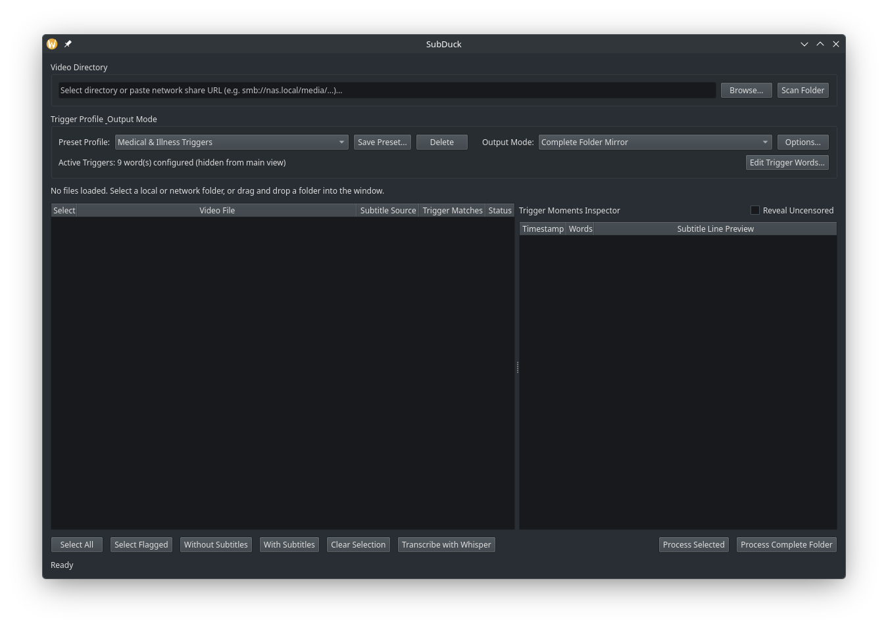
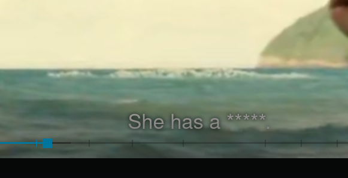
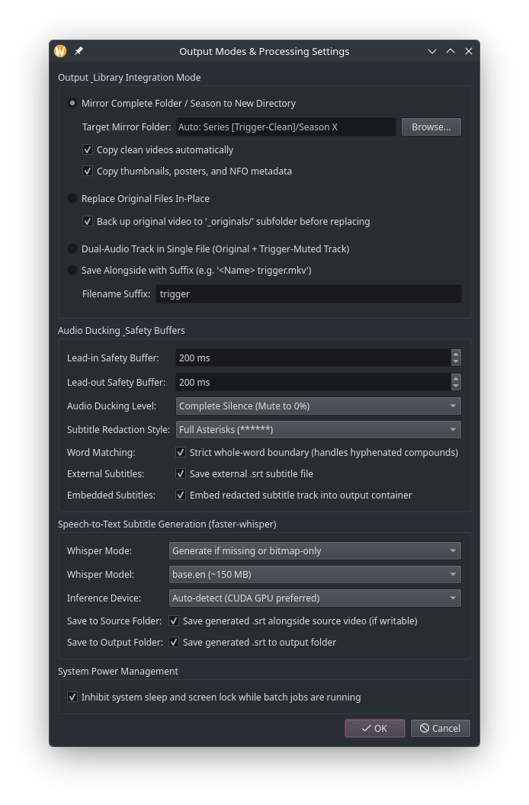

# SubDuck

PySide6 desktop tool for scanning video files against custom trigger word lists, muting or ducking the audio around matched dialogue, and redacting the subtitle track without re-encoding the video stream (`-c:v copy`).



If a video doesn't have text subtitles (or only has Blu-ray PGS / DVD VobSub bitmap subtitles), SubDuck can extract a temporary 16 kHz mono WAV and transcribe it locally with `faster-whisper`. Matched trigger words are cleanly muted or ducked in the audio stream and redacted from the subtitle track:



## Requirements

- Python 3.10+
- `ffmpeg` and `ffprobe` in `PATH` (`sudo pacman -S ffmpeg` or `sudo apt install ffmpeg`)
- Optional: NVIDIA GPU with CUDA 12 libraries for `faster-whisper` (`float16`). If `nvidia-cublas-cu12` and `nvidia-cudnn-cu12` are installed inside `.venv`, SubDuck preloads the `.so` files at startup so you don't need to export `LD_LIBRARY_PATH` manually.

## Setup

```bash
git clone https://github.com/kirasummers/SubDuck.git
cd SubDuck
python3 -m venv .venv
source .venv/bin/activate
pip install -e .
```

Run with `subduck` or `python3 main.py`.

## How it works

1. Point the app at a local folder or drag a folder in from Dolphin (`smb://` and `sftp://` URLs are mounted automatically via `kio-fuse` on KDE).
2. Pick a trigger profile or edit the word list via **Edit Trigger Words...** (words stay hidden on the main window unless revealed).
3. Choose an output mode:
   - **Complete Folder Mirror**: writes a parallel folder (`<Series> [Trigger-Clean]/Season X`) with original filenames so Jellyfin/Plex don't merge filtered and unfiltered episodes into one entry. Clean episodes, posters, and `.nfo` files are copied across.
   - **In-Place Replace**: moves the original file into `_originals/` and writes the filtered file in place.
   - **Dual-Audio Track**: keeps the original audio track alongside the filtered track (set as default) in the same container.
   - **Save Alongside with Suffix**: outputs `<Name> trigger.<ext>` next to the source video.

## Settings & Configuration

Fine-tune safety buffers, ducking volume, Whisper models, and hardware acceleration in the **Settings** dialog:



## Tests

```bash
pytest
```

## License

MIT
